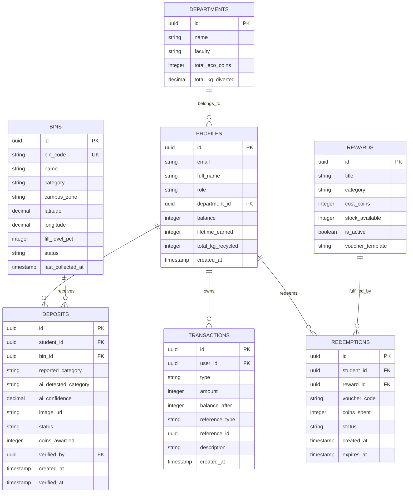

# EcoCoin: Project Architecture, Plan & Database Schema

## 1. System Architecture Overview

EcoCoin is an enterprise-grade campus sustainability and waste-management web application. It combines student incentives (EcoCoins), automated Computer Vision classification, IoT-enabled Campus Digital Twin bin telemetry, and an auditable financial-style ledger for credits and redemptions.

```
                  +----------------------------------------------+
                  |         Client Layer (React + Vite)          |
                  | - Tailwind CSS & Lucide Icons                |
                  | - Interactive 2D Leaflet & 3D Three.js Twin  |
                  | - QR Scanner & Camera Waste Capture          |
                  | - Dual Engine: Supabase Client & Mock Engine |
                  +-----------------------+----------------------+
                                          |
                      +-------------------+--------------------+
                      |                                        |
                      v                                        v
+---------------------------------------+   +--------------------------------------+
|    Supabase / PostgreSQL Database     |   |    Python FastAPI Service (CV & AI)  |
| - Row-Level Security (RLS)            |   | - Ultralytics YOLO Waste Classifier  |
| - ACID Coin Transaction Ledger        |   | - Bounding Box & Annotation Pipeline |
| - Stored Procedures (award/redeem)    |   | - Verification Threshold Logic       |
| - Real-time Subscriptions (Bins & TX) |   | - Digital Twin IoT Telemetry Sim     |
+---------------------------------------+   +--------------------------------------+
```

---

## 2. Key Requirements & Security Posture

1. **Tamper-Proof EcoCoin Ledger**:
   - Students **NEVER** have direct `UPDATE` privileges on their `balance` column.
   - Balances are updated **exclusively** via secure PostgreSQL Stored Procedures (`award_deposit_coins` and `redeem_reward_voucher`) or authenticated backend service-role API calls.
   - Every coin movement generates an immutable record in `transactions` with an audit trail (timestamp, reference ID, delta, resulting balance).

2. **Proof-of-Deposit Multi-Factor Verification**:
   - QR code scanning verifies bin location and type, but **does not** prove a deposit occurred.
   - Deposits require photo capture/upload evaluated by Computer Vision.
   - Predictions below the confidence threshold (e.g., < 85%) or mismatched with bin type enter a `NEEDS_STAFF_REVIEW` status.
   - EcoCoins are **only** credited once the deposit status transitions to `APPROVED`.

3. **Digital Twin Campus Architecture**:
   - 2D Leaflet GIS Map displaying campus zones (North Campus, Science Quad, Student Union, Residence Halls).
   - 3D Three.js Isometric Digital Twin visualizing campus topography, buildings, and live bin fill levels.
   - Modular component design allowing seamless switching between 2D GIS and 3D WebGL renderers.

4. **Zero-Config Developer Experience**:
   - Runs instantly in mock data mode without requiring third-party credentials or a dedicated GPU.
   - Instant toggle to connect to live Supabase and FastAPI backend services.

---

## 3. Database Schema (PostgreSQL / Supabase)

### 3.1 Entity Relationship Diagram



---

## 4. Implementation Stages

| Stage | Focus Area | Deliverables | Status |
| :--- | :--- | :--- | :--- |
| **Stage 1** | Architecture & DB Schema | Project Plan, DDL SQL schema with RLS & Stored Procedures | **Current** |
| **Stage 2** | Frontend Foundation & Mock Engine | React + Tailwind + Vite app, state store, mock data seed | Next |
| **Stage 3** | Core Student & Admin Workflows | Dashboard, QR Scanner, Deposit submission, Ledger, Admin Queue, Rewards Store | Upcoming |
| **Stage 4** | Campus Digital Twin | 2D Leaflet interactive map + 3D Three.js Campus Digital Twin visualization | Upcoming |
| **Stage 5** | FastAPI Computer Vision Service | Ultralytics YOLO waste classifier, annotation overlay, verification rules | Upcoming |
| **Stage 6** | E2E Integration & Deployment Guide | Unified runner, automated test suite, Supabase configuration guide | Final |
